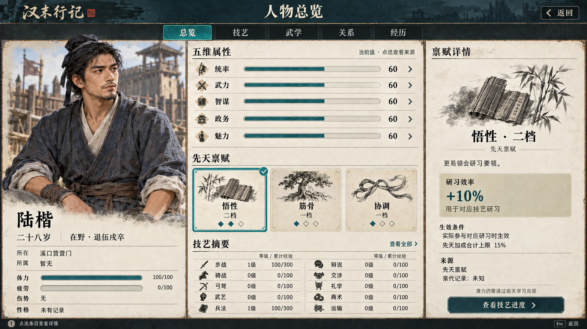

# 人物总览 属性与禀赋 v0.1

更新于 2026 年 10 月 6 日。状态：**三卡版容量表达需修订，保留过程记录**。对应《汉末美术设计》v0.25、UI-16 人物与关系。

用户指出三张固定大卡容易被理解为全部天赋或三个槽位。当前改用 [v0.2 列表版](../v0.2/README.md)，原图与提示词保留；本版未因继续修订而通过评审。

这张图呈现完整人物总览：左侧人物身份与身体状态，中间五项属性、先天禀赋和十项普通技艺，右侧为已选“悟性二档”的来源与影响。顶部总览、技艺、武学、关系、经历切换详细内容。三栏的设计基准约为 28%／44%／28%；生成图的肖像栏略宽，正式布局仍须按文字可读性与窗口尺寸调整。

## 来源与画面状态

来源快照为 `c462c204afb132405ff7c18c7c68f619d112c8be`，分支 `work/alpha-integration`。这是一张采用现有数据和候选设计的视觉目标，不是从运行游戏捕获的截图。

| 项目 | 画面值 | 依据或限制 |
| --- | --- | --- |
| 人物 | 陆楷，28 岁 | 清溪粮道 1.0 的原创玩家人物 |
| 身份与位置 | 在野，退伍戍卒；溪口营营门 | 内容包开局，尚未受任溪口领队；“所属暂无”是当前样例表达，不是由未任官通用推算所有组织关系 |
| 五属性 | 统率、武力、智谋、政务、魅力均 60 | 内容包实际初始属性；没有为排版制造不同数值或额外属性预算 |
| 体力与状态 | 体力 100/100、疲劳 0/100、无伤势 | WorldFactory 新局初始化口径；不是上一张攻城后的状态 |
| 普通技艺 | 步战、兵法各 1 级，累计经验 100/300；其余八项 0 级、0/100 | 源数据是累计经验；等级由既有门槛派生 |
| 禀赋示例 | 悟性二档、筋骨一档、协调一档 | 正式成长设计 §3.14 的候选族及档位，用来展示界面，不是清溪人物实际已保存的禀赋 |
| 选中效果 | 对应研习效率 +10%，先天加成合计上限 15% | 来自候选学习效率口径；具体适用技艺还须作者定义，不承诺已经接入当前课程结算 |
| 未知信息 | 性格未有记录，亲代记录未知 | 不将资料缺失填为数值零，也不虚构性格、亲缘或遗传来源 |
| 肖像 | 同一张原创半身示意 | 仅承担本页身份焦点；未校准为运行画像，未证明现有人物分层组合兼容 |

清溪初始十项技艺依次为步战、骑战、弓弩、武艺、兵法、辩说、交涉、礼学、商术、运输。累计经验门槛为 0、100、300、650、1200，对应 0—4 级。图中 100/300 表示当前累计经验与下一级累计门槛；不是“在当前等级已经完成 100/300”。满级在实际界面显示已满级，缺失或非法经验显示未知，不补 0。

本页回到同一角色的开局样例，没有把攻城图中的已受任、军团、攻具与战报状态带入该人物资料。任何后续当前状态都应从真实存档读取，不能从目标图反建世界。

## 现有数据与待接入内容

- 现有 `character_input.gd` 提供姓名、真实年龄及公开外观输入；`world_factory.gd` 已建立人物属性、技能与身体状态。
- `ordinary_skills_view.gd` 提供本人十项技能的经验、派生等级、下一门槛和已结课记录。读页不会结算课程、授奖或推进半日，课中待结算经验不能作为已获得成果。
- `character_summary.gd` 已提供武学熟练、师承、装备、护具、心法及行囊的有限数据。它不是本图所有人物属性与禀赋的统一接口；既有“skills”分支指武学，不能与十项普通技艺混用。
- 本图的统一总览、页签组合、属性来源详情、禀赋投影和效果说明属于待接入的 UI 目标。基础／成长／装备／暂时修正不能由 UI 猜分，也不因绘制了 +10% 就改变结算公式。
- 先天禀赋、性格及已学技艺保持不同语义。档位不是可自由花点升级的天赋树；学习仍须实际行动和合法来源，亲代资料未知时也不能反推遗传结果。

## 操作与层级

当前总览页保持“悟性二档”选中，中部青色边框和两枚实心档位标记对应右侧标题。点其他属性或禀赋仅替换详情，姓名、肖像、页签和列表位置保持。技艺“查看全部”与右侧“查看技艺进度”进入本人技艺页；武学、关系和经历分别展开，不在首页同时铺满。

查看与切页不新增命令、不增加数值、不推进时间。返回恢复进入前的场所或活动。实际修业、修炼、传授、装备与心法切换继续经过既有预览和提交，不从总览绕过地点、权限、物资或时间条件。

第一张没有属性加点、禀赋升级、重抽、全局战力或人物总等级。正式开发时，尚无数据的项目按能力与可知范围处理；本图中的候选状态不作为生产默认值。

## 素材与检查

`character-overview-ui.png` 为内置 ImageGen 单次生成的 1672×941 RGB PNG，没有放大、程序拼贴或运行时控件叠加。实际提示词见 [prompt.md](prompt.md)。图片为同一张烘焙图，肖像、底材、图标、数字与按钮均需后续分层，正文和动态数值由引擎排版。

已目视检查五项属性、十项技能的名称和值、三项禀赋档位、选中与详情一致性、身体状态和返回入口；源文件尺寸、字节大小及哈希另录 manifest。Page 原生图片已上传并读回同一字节摘要，Page 文本与插入结构已读回核对。未进行 Page 渲染器截图验收、Godot 接入、真实字体度量、窄窗、大字号或交互验证。

人物生产仍按既有决定暂缓。本图半身像不是新的部件母版，也不将先前失败的组合试验改成通过。衣饰为游戏绘画方向，正式资产仍须时代依据校对。

## 固定来源

- 人物、关系、成长设计 §3.1、§3.2、§3.14（未公开）
- 清溪粮道内容包（未公开）
- 人物新局初始化（未公开）
- 公开人物表现输入（未公开）
- 普通技艺等级与门槛（未公开）
- 普通技艺总览只读数据（未公开）
- 武学、装备与行囊只读数据（未公开）
- 完整美术设计文档（未公开）

本次仅增加美术目标图与设计说明，不修改游戏代码、运行资源清单、人物数据或成长结算。
