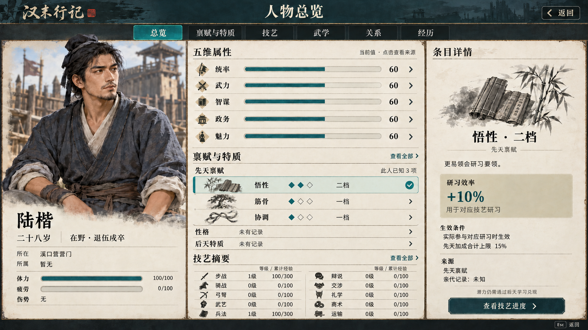

# 人物总览 禀赋与特质列表 v0.2

更新于 2026 年 10 月 6 日。状态：**静态界面目标图待用户评审**。对应《汉末美术设计》v0.26、UI-16。

v0.1 的三张大卡容易被理解成全游戏只有三个天赋或每人固定三槽。v0.2 将该区域改成按人物生成的紧凑列表，明确标注“此人已知 3 项”，加入“查看全部”与“禀赋与特质”页签，并将性格、后天特质单独成组。肖像、五项属性、十项普通技艺和右侧悟性详情延续前版。

## 数量与档位

以下三种数量独立定义，不能互相代替：

- 游戏禀赋总库的族数：尚未形成完整冻结清单。正式设计 §3.14 的悟性、筋骨、协调只是首轮候选。
- 单个人物实际持有的条目数：服从人物与内容规则；本轮没有新设上限、槽位、预算或抽取次数。
- 总览一次显示的行数：只属于界面容量。常规字号先显示最多 4 行，多出部分显示“另有 N 项”和查看全部，完整页按需要滚动；大字号可减少摘要行数，不改变人物条目。

每族候选一至三档指单个禀赋的档位，不是三种禀赋或三个持有槽。同族只展示当前档位；低档被高档替代时，来源与历史在详情展开，不能叠成多个独立增益。

本图仍选三个候选条目展示同一人物，仅用来比较新旧信息结构。计数属于此人的先天禀赋，不包含性格、后天特质、技艺或未获知内容。并未新增一套虚构的全库数量。

## 四类信息的范围

| 信息组 | 含义与边界 | 当前依据与展示方式 |
| --- | --- | --- |
| 先天禀赋 | 出生潜力；同一族只保留一个当前档位，不能代替已学本领 | §3.14 仅列悟性、筋骨、协调等首轮候选；族数、互斥及效果尚未齐备。按当前人物已知条目显示，不以三项作为总库或人物上限 |
| 性格 | 处事倾向、兴趣及经历形成的变化，与禀赋档位分开 | §3.15 保留持续形成的方向；现有 social.kind 的 cooperative/selfish 是特定行为配置，不等于完整性格系统，也不直接翻译成对整个人物的评价 |
| 后天特质 | 由已发生经历形成、有来源和有效条件的长期特征 | 本轮仅确定独立展示分组；独立目录和规则尚未冻结。既有称号、卡片及事件标记保留原类别，引用同一效果，不另造同名增益叠加 |
| 已学技艺与武学 | 实际学习成果，包含经验、等级或熟练及师承 | 复用普通技艺和武学的现有接口，仍需学习、修炼与合法来源；不从父母、身份或一张禀赋图直接获得 |

这四组是表现层分类。正式成长设计将先天禀赋、后天性格／成长、已学技能／修为分别处理；本次为阅读清楚，将中间一类拆成性格与后天特质两组，没有借界面增加四套独立成长机制。

## 设计与现有代码的差距

以 `bb7c414e9186384c383258dfba141ea958b5b8c1` 为核对快照：

- `schemas/content.schema.json` 的 actor 定义已有 attributes、skills、combat、social、appearance 等字段，但没有独立完整的先天禀赋、性格特征及后天特质目录。
- `social.kind` 的 cooperative／selfish 与目标人物、行动间隔、是否分享消息和食物配置一起使用，属于特定行为设置。不能把它当成完整性格图鉴、固定道德评价，或直接生成全部人物性格标签。
- `actor_behavior.gd` 目前调度 travel_plan、military_plan 和 social；`actor_identity.gd` 与原生 family_model 的人物创建资料保留真实身份、属性、技能和外观基础。本次核对不将这些数据冒充完整禀赋成长。
- `ordinary_skills_view.gd` 仍负责本人十项普通技艺及终态课程来源；`character_summary.gd` 负责武学、装备、护具、心法、行囊与师承。本图的全套列表和四组详情没有因此变成已接入页面。
- “后天特质”独立目录、有效期限、移除和互斥等规则尚未冻结。若未来显示既有称号、技艺卡或经历标记，须明确原类别并引用同一规则效果，不能复制成第二份加成。

完整内容目录至少应逐条说明名称、信息组、获得或形成来源、当前档位或状态、有效条件、适用范围、排他／替换关系及可知范围。条目数和游戏规则由正式设计确定，不能从这张图的三行反向生成。

## 列表和完整页的状态

| 状态 | 总览表现 | 全部条目页与返回 |
| --- | --- | --- |
| 已确认没有条目 | 显示“暂无”，不画空槽 | 保留分类与说明，不虚构待解锁项 |
| 资料未记录或不可知 | 显示“未有记录”或“未知”，不显示 0 项 | 只展示可知信息；不得用列表长度反推总数 |
| 当前人物少量已知条目 | 显示实际条目；本图为 3 行，无空位和滚动条 | “查看全部”仍为统一入口；3 是样例人物计数，不是游戏总库数量 |
| 已知条目较多 | 常规字号先显示最多 4 行，另示“另有 N 项”及查看全部；不缩小字塞满 | 按组列全，必要时滚动；返回保持分类、选择和滚动位置 |
| 同族档位与状态变化 | 只列当前有效档位，来源与历史在详情中展开 | 不将一、二、三档算成三个不同天赋，也不把临时伤病混为永久特质 |

总览“查看全部”和“禀赋与特质”页签指向同一个人物的完整条目页，不是揭示全世界隐藏天赋的图鉴。可按分组查看，条目较多时再提供必要的搜索；右侧沿当前选中项展示作用、条件与来源。返回恢复原人物、分类、选择和滚动位置。

列表选中、切页、查看、滚动与返回均不提交成长，不加点、不重抽、不推进半日。真实学习、修炼、传授或装备操作继续走既有预览和提交。暂无与未知必须由数据含义区分，不能由空数组随意推断。对于尚未接入能力的部署，是否隐藏入口或提示不可用须按能力状态决定，不能将“未有记录”用作全部实现缺口的通用遮掩。

## 本图数据与素材

陆楷仍为清溪粮道 1.0 开局示例：28 岁，尚未受任，五属性均 60；步战和兵法累计经验各 100，均显示 1 级、100/300，其余八项 0 级、0/100。体力 100、疲劳 0、无伤势；未沿用上一张攻城图的已受任和战斗状态。

悟性二档、筋骨一档、协调一档及 +10% 研习效率、先天合计上限 15% 仍是正式文档中的候选方向，并未写入清溪人物或结算。性格和后天特质的未知行是目标状态示范，不证明后端已有完整分类；也不临时填造额外天赋来表现容量。具体适用技艺、全部禀赋清单、互斥和来源规则仍需正式确定。

图片使用内置 ImageGen 对 [v0.1](../v0.1/character-overview-ui.png) 局部编辑，实际输出 1672×941 RGB PNG，没有放大或程序拼贴。编辑提示词见 [prompt.md](prompt.md)。文字、肖像和控件仍烘焙在一张图中，正式动态文本、列表和点击区域需由引擎绘制；人物部件生产暂停的决定不变。

## 核验范围

已目视核对六个页签、个人范围计数、三行档位标记、性格与后天特质分组、查看全部入口、右侧选中对应，以及原有五项属性、十项技艺和身体状态。文件尺寸和哈希录入 manifest；Page 原生图片已读回核对摘要，正文及结构已读回检查。

本轮未生成完整条目页或多于摘要容量的另一张状态图，也未完成实际滚动／搜索／返回保持、字体、大字号、窄窗或 Godot 接入验收。没有 Page 渲染器截图证明；图片可读回与 Markdown 保存不代表全部动态布局通过。

## 固定来源

- 人物成长设计 §3.14—3.15（未公开）
- 作者内容 schema（未公开）
- 人物行为调度（未公开）
- 动态人物身份（未公开）
- 原生家庭人物模型（未公开）
- 普通技艺投影（未公开）
- 武学与行囊投影（未公开）
- 完整美术设计（未公开）

本次只修改美术目标与说明。未修改人物数据、游戏机制、作者 schema、运行资源清单或游戏代码。v0.1 标记为容量表达需修订，原图和生成提示保留，其余图组评审状态不变。
