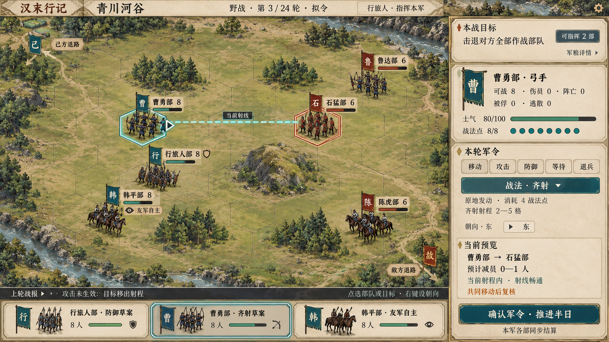

# 青川河谷军队野战完整界面 v0.1

状态：**静态视觉目标，待用户评审。** 生成日期：2026-10-04。

本图承接现有六角野战、同步拟令和指挥权限。左侧为战场，右侧集中目标、选中部队、军令与条件预览，下方是部队名册和上轮战报。保持精细二维半写实、素纸铜金边框与青色选中态。

## 已核对的依据

主要读取基线为 `0738fc809dff27c026179a40b6d7cb5cf729e131`；后续合并 `6e554f85822c5cb19f4c8ea4f7ddf30f083dd7dc` 未改变下列野战规则和正式 Alpha 内容。

- [野战正式设计](../../../../docs/superpowers/specs/2026-09-09-hanmo/05_duel_and_warfare.md)与机制基线（未公开）。
- [界面](../../../../game/ui/military_battle_screen.gd)、[画布](../../../../game/ui/military_battle_canvas.gd)、[军粮显示](../../../../game/ui/military_logistics.gd)。
- [军令查询](../../../../game/core/military_combat.gd)、[轮次结算](../../../../game/core/military_round.gd)、[六角几何](../../../../game/core/military_hex.gd)、[减员计算](../../../../game/core/domains/military/military_damage.gd)。
- [正式 Alpha 内容](../../../../content/foundation/alpha_life.json)、[界面测试](../../../../game/tests/test_military_battle_screen.gd)及现有验证记录。读取记录不等于重新运行测试。
- 用户提供的野战分析（私人对话链接已移除）：采用身份权限、具体军令条件、地形兵种可读性和可信结果解释的建议。

同时核对了清溪粮道内容与白石谷测试夹具；本图选择正式 Alpha 的青川河谷作为视觉背景，不把测试夹具称作已开放的正式任务。

## 示例状态与规则对应

| 项目 | 本图采用 | 边界 |
| --- | --- | --- |
| 地图 | 青川河谷，正式数据为 10×7 共 70 个轴坐标六角格 | 绘图不是精确格位截图；地形和射线接入时由规则重绘 |
| 地形 | 林地 (3,1)、(6,1)、(3,5)、(6,5)，丘陵 (5,3)，其余平地 | 边缘溪流是装饰；不能因此增加地图内水格或把山丘改成不可通行岩壁 |
| 我方 | 行旅人部步卒 8，曹勇部弓手 8，韩平部骑从 8 | 兵种与 8 人尺度来自正式内容；玩家替代主将、两部授权与一部自主友军是能力组合示例 |
| 对方 | 石猛部步卒 6，鲁达部弓手 6，陈虎部骑从 6 | 名称、兵种与 6 人尺度来自正式内容；阵位和士气为构图示例 |
| 拟令 | 行旅人部防御，曹勇部原地齐射；韩平部只读 | 只处理授权单位的本轮命令，不显示其他单位的未公开意图 |
| 齐射 | 弓手可用，消耗 4 战法点，原地发动，射程 2—5 格 | 普通弓射射程为 2—4；不能把齐射射程当作所有攻击射程 |
| 预览 | 士气 80、战法点 8/8、预计减员 0—1 人，移动后复核 | 依据现有公式选取的示例，不是一次引擎运行或回放验证 |
| 目标与时间 | 击退对方全部作战部队，第 3/24 轮，确认推进半日 | 轮次为示意，不叠加驻守、护送或突围目标 |
| 人员 | 可战、伤员、阵亡、被俘、逃散分别列出 | 减员不是全部死亡；也不保证战后全部伤员恢复 |
| 控制权 | 本军可指挥 2 部，自主友军可查看 | 全军权限接口已有测试，不能据此宣称高阶统军生涯已完整开放 |

齐射示例按弓手 8 人、攻击 32、士气 80、战法威力 12000、对方步卒防御 18、平地正面且无额外状态估算。当前整数计算得到潜在减员 1，集体减员系数 88%，因而结果区间为 0—1。该系数不是整次攻击成功或失败的单次命中概率。实际预览必须从当前规则查询取得，不能照抄此数字。

## 采用的界面改进

- 权限同时出现在目标区、部队标签与名册中；同阵营颜色不代表全部可指挥。
- 将当前射程和射线事实与“共同移动后复核”分开；齐射不画移动路径。
- 部队名册不是行动序；保留固定“确认军令 · 推进半日”。
- 军粮先提供详情入口，实际内容由真实军队身份和补给报价决定，不编造粮食库存。
- 上轮战报“目标移出射程”是表现示例。现有移动阻塞事件未提供完整阻塞者和责任链，不能承诺精确解释是谁抢格。

底部名册、折叠战报和调整后的预览文案尚未接入游戏。正式 Alpha 当前只配置鼓舞、突击、齐射；底层支持的支援、行军、侧击、佯退、压制等战法不能据此默认出现在所有部队中。持续任务、共享指挥点、自动长时作战及改换回合形式未纳入本轮。

## 交付与验证状态

- `field-battle-ui.png`：1672×941 RGB PNG，2,931,876 字节。
- SHA-256：`d18b2432efb0a617ab3d946aee3ee14b493f9049b48922c260d7f3e3c135a452`。
- `prompt.md`：本图实际生成提示词，保留图像生成过程依据。

已目视检查整体布局、六部标签、己方与敌方退路、原地齐射、权限、人员分类和确认入口。格数、落格、射线、地形边界及所有数值状态尚未通过引擎校准；图中兵士是代表符号，不要求人物数量与标签人数逐个对应。

本轮仅新增美术与文档资料，没有更改战斗规则、游戏代码或运行资源路径。实际运行需要独立地表、树林与山丘、兵士、旗帜、命令叠层和 UI；整图不能作为已完成拆层、程序组合、动作动画、Godot 交互或大字号验收的证据。个人战及其他既有图片的评审状态保持原样。
