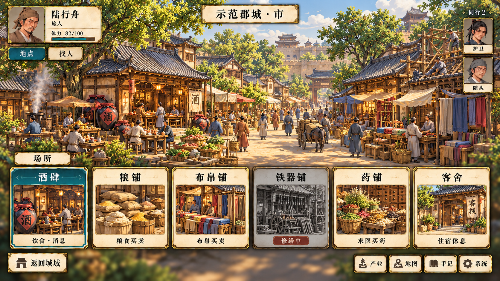

# 市场街区立绘与场所卡片备选 v0.1

日期：2026-10-03。状态：**首屏六处容量不足，当前方案见 [v0.4 单排堆叠卡片](../card-fallback-v0.4/README.md)**。

用户要求调整卡片形态以容纳更多场所；中间的 v0.2 双排及36处目录假设已被退回。以下图和说明仅作初版记录，不作为现行数量或分页要求；当前采用 v0.4 单排堆叠图卡，数量服从既定游戏内容。

本方案用于独立建筑动态组合难以达到目标质量或制作量难以承担的情况。参考经典城镇访问界面的形式，以街区立绘提供氛围，以底部场所卡片承担访问操作；保留主方案已认可的精细二维画风。

## 图中界面

上方为街区绘景，移除建筑上的浮动访问标记。底部有六张场所卡片，保留玩家信息、地点／找人、右侧两名同行、返回城域及产业／地图／手记／系统入口。

| 卡片 | 展示内容 |
| --- | --- |
| 酒肆 | 饮食·消息，黛青焦点状态 |
| 粮铺 | 粮食买卖 |
| 布帛铺 | 布帛买卖 |
| 铁器铺 | 灰色与“修缮中”，暂不可用示意 |
| 药铺 | 求医买药 |
| 客舍 | 住宿休息 |

可用卡片本身就是访问入口，不另设“前往”确认，不显示城内导航或移动计时。进入具体场所后使用既定本处、来客和同行人物分组。

## 实际游戏中的变化

- 卡片来自各城真实场所，不固定为六种服务。不存在的场所不显示，同类多店使用具体名称区分。
- 新建、拆除、迁址、营业与修缮状态改变卡片及关联对象；场所较多时分页或展开完整列表。
- 背景按地域或整体街区类型选择有限变体，不按每一种建筑组合重绘。背景里的店面与装饰人群不代表精确地点、库存或在场人物。
- 旅人产业、城主规划与官员授权规则继续保留；精确布局、升级和工程事务在独立规划或管理视图中办理。
- 本图只展示日常访问，备选方案的规划视图及多场所展开尚未出图。

## 检查与边界

实际输出 **1672×941 RGB PNG**。已目视检查六张卡片、主要文字、修缮禁用示意、同行和返回入口。

当前仍是 ImageGen 生成的完整效果图，不是交互程序。运行时背景、卡片图、名称、状态、按钮和同行 UI 须分别制作并由数据驱动；未完成拆层、正式源图规格、浏览器、Godot、窄窗及大字号验收。

## 文件与关联

- `market-cards-ui.png`：备选效果图。
- [prompt.md](prompt.md)：完整提示词及参考来源。
- [主方案效果参考与生产要求](../v0.1/README.md)。
- 完整美术设计（未公开）。
