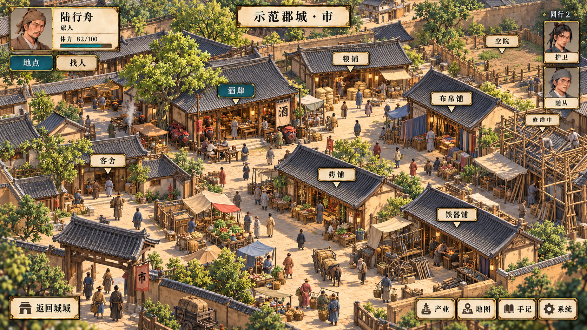

# 市场街区最终视觉效果参考 v0.1

日期：2026-10-03。状态：**画风与界面设计已获用户认可；实际动态组合尚未验证**。

本图保留为游戏最终视觉效果的参考，规定材质、建筑密度、街市气氛及界面语言。它由 ImageGen 整图生成，建筑、环境、人物与 UI 已烘焙在一起，不是程序拼接结果，不能证明可变街区已经实现，也不是可直接交付游戏的组合素材。

## 主方案的实际生产方式

采用街区布局模板与独立建筑组件。各城保存自己的地形、道路、地块、建筑与经营状态，由程序组合显示，不为每一种布局另画整幅图。

| 独立内容 | 要求 |
| --- | --- |
| 环境与道路 | 地面完整，建筑移除后不留空洞；道路和背景按布局组织 |
| 地块布局 | 定义占地、入口、朝向及道路接入，支持规则允许的替换、扩建或合并 |
| 建筑与院落 | 先以整栋或完整院落为单位，统一镜头、比例、底部锚点、光照及少量朝向 |
| 装饰与状态 | 货物、招牌、施工、完工及破损按需独立，附着具体建筑或地块 |
| 人物与 UI | 可交互人物、入口标记、文字与按钮保持独立，读取真实对象状态 |

普通建筑可在结构适合时复用房屋主体，再更换门面装饰；具有专用空间需求的设施使用专用组件。城域总览与局部街区共用地块、建筑和状态数据，采用不同尺度的表现。

## 尚未完成的组合验证

最终组合须由脚本或游戏程序执行，ImageGen 可用于制作单体素材。验收需提供独立素材、布局配置和可运行组合代码，用同一批文件实际生成至少两种布局，并检查建筑移除、换位、替换及施工状态切换后的地面、接缝、阴影、遮挡、入口和标记。

**目前仅完成效果参考图，尚未执行上述验证。** 程序能够叠加图片，不等于拼接后的美术质量已达到本图；独立素材的一致性仍是待验证项。

## 备选路径

如果独立素材难以稳定组合出目标效果，或制作维护成本难以承担，可采用[街区立绘与底部场所卡片](../card-fallback-v0.4/README.md)：背景表达氛围，真实场所及状态由动态卡片和管理视图表示。该备选已修订为保持卡片宽度的单排堆叠图卡，待评审；场所数量服从既定内容，双排及36处目录假设已撤销。

## 检查与文件

当前 PNG 为 **1672×941 RGB**，主要地点标签、巷道、店铺、空院与修缮架已目视检查。暂定 2560×1440 源图规格、拆层、热点、真实交互及 Godot 验收未完成。

- `market-district-ui.png`：获认可的最终视觉效果参考，像素内容保留。
- [prompt.md](prompt.md)：原始整图生成提示词，不是组合脚本。
- [城域 v0.3](../../city-overview/v0.3/README.md)与[酒肆内景](../../scene-layout/v4/browse.png)。
- 完整美术设计（未公开）。
