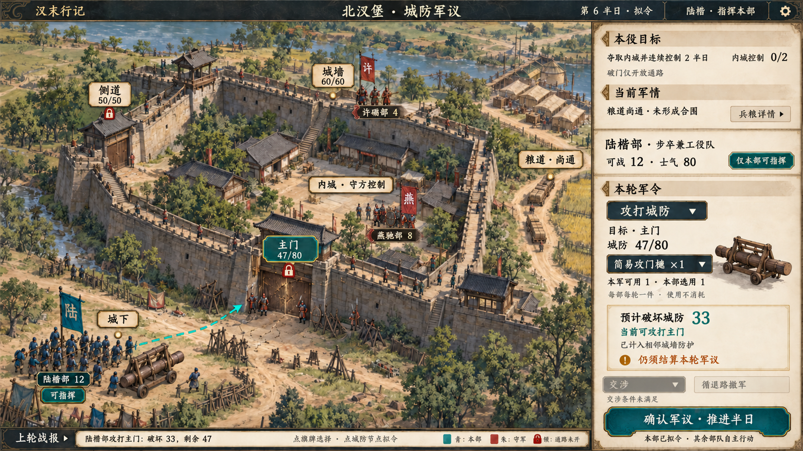

# 北汊堡城防军议 v0.1

状态：**静态视觉目标，待用户评审。** 日期：2026-10-06。

采用清溪粮道 1.0 的城防配置。左侧是城寨绘景、可点击节点和部队旗牌，右侧集中目标、军情、本部军令、攻具及城防破坏预览，固定确认按钮推进同一世界半日。此图表现主门攻坚；局部节点会战与交涉整编另作后续画面。

## 依据与当前边界

本图对照 `work/alpha-integration` 的 `fead0b1a1a5c1fd1382da4bbd8979ebefc364130`：

- [战争设计第 5.10 节](../../../../docs/superpowers/specs/2026-09-09-hanmo/05_duel_and_warfare.md)。
- [清溪 1.0 内容说明](../../../../content/packs/authored/qingxi_campaign/README.md)与[内容数据](../../../../content/packs/authored/qingxi_campaign/content.json)。
- [当前城防规则](../../../../native/world/src/resident/domains/military/siege_rules.cpp)、[世界接线](../../../../native/world/src/resident/domains/military/siege_world.cpp)、[有限页面查询](../../../../native/world/src/resident/domains/military/siege_views.cpp)。
- [军议界面](../../../../game/ui/siege_screen.gd)与已有攻具实际操作记录（未公开）。

已有实际操作记录绑定源码 `9e047e6`，覆盖选择、取消、重选、异步重绘、半日攻城和实际破坏反馈；其使用旧 Alpha 库存，并未证明清溪攻具制造完整通关或本图像素验收。本轮读取记录，没有重新运行游戏测试。

截至上述核对提交，清溪 1.1 的逐将决议、军籍与公产交接已有源码，组合构建、实际 Main 和存读仍待相应节点验证。该开发状态以 GOAL_PROGRESS.md（未公开） 后续记录为准。本图采用 1.0 普通攻城，不显示整编成功或新增接收权限。

## 图中示例

| 项目 | 取值与含义 |
| --- | --- |
| 地点 | 北汊堡，汉末背景原创据点，不是历史城池考据复原 |
| 玩家 | 陆楷，单位级公职，仅可指挥本部 |
| 攻军 | 12 人步卒兼工役队；图中人物是代表符号，不逐人映射 |
| 守军 | 燕驰巡军 8 人、许砺弓队 4 人 |
| 城防 | 主门上限 80，侧障 50，城墙 60 |
| 当前状态 | 第 6 半日、主门剩余 47、内城控制 0/2、粮道尚通、士气 80 |
| 攻具 | 本军已有简易攻门槌 1 件，本部显式选用 1 件 |
| 预览与战报 | 本轮预计破坏 33；上轮示例破坏 33，主门从 80 降至 47 |

人物名称、初始人数尺度、节点定义、权限及攻具规则来自作者内容。轮次、当前人数保持初值、士气、损伤、已制器械、部队落点和战报是用于说明规则的组合状态，不是读取某次存档得到，也不承诺该状态必然自然发生。

单部不满足清溪 1.0 的两部合围要求，所以图中保持“未形成合围”。本例也假设尚不满足所选交涉的真实资格。城内粮食、公共库存和入阵援军应由实际有限查询提供，图中使用兵粮详情入口，不编造库存数字。

## 城防节点和攻具规则

本例有城下、主门、侧道、城墙、内城、粮道六处节点；其他城池的节点数量和连接由各自定义决定。清溪 1.0 原连接为：

| 连接 | 阻挡 |
| --- | --- |
| 城下—主门 | 无门障 |
| 主门—内城 | 主门耐久大于 0 时阻挡攻方 |
| 城下—侧道 | 无门障 |
| 侧道—内城 | 侧障耐久大于 0 时阻挡攻方 |
| 城墙—主门 | 无门障 |
| 城墙—侧道 | 无门障 |
| 城墙—内城 | 无门障 |
| 内城—粮道 | 无门障 |

图中的青色虚线止于主门，表示攻打目标，不表示已经穿门移动。锁标应绑定门区阻挡边；内城守方控制不是新增独立锁。接敌调用节点对应六角战场，不在这张总览铺满六角格。

攻门槌是 `item.ram`“简易攻门槌”，不是旧 Alpha 的长矛占位。制造实际消耗木材 10、铁料 2、4 个半日，成品下一轮可用。只能选择本军公共未预留库存；一部一轮最多一件，一件不能同时供多部，使用本身不销毁成品。图中已经备妥，不同时显示制造中或重复消耗材料。

本部 12 人时，结构伤害按现有代码为基础 20＋整数除法 12/50＋攻具 20，再计相邻完好城墙 `wall_defense_bp=12000`，得到 `floor(40×10000/12000)=33`。当前公式没有读取旧候选设计中的筑城等级，图中也不添加该加成。此处只说明选定示例；实际预览必须查询当前规则，不能固定写入 33。

破门只开放相应通路。占领还要求内城无有效守军及未结节点会战，并满足连续控制要求；清溪为 2 半日。守军、伤员、俘虏及物资不能因门耐久归零而消失。

## 画面与运行的关系

- 样图延续精细二维半写实、素纸铜金边框和青色选择状态。城寨绘景代替纯节点方框作为视觉主体，功能仍由节点与真实通路决定。
- 现有军令选择器包含移动、攻城、封锁、营造、修缮、出击、待命。图中只展开当前攻城选择，不默认所有动作对所有身份都可用。
- 第一张生成图将锁标放在内城、燕驰旗牌放在门外；一次局部编辑已将锁标移至主门、主要守门队形与旗牌移至门内侧。
- 门外及墙头仍有零散岗哨绘景，不代表额外可操作部队。实际接入须按单位节点位置重绘，避免与旗牌所属队形重复或位置冲突。
- 通路的全部连边、遮挡和单位锚点未逐项几何校准。绘景、墙门完好／受损／突破状态、兵士、旗帜、通路、节点和 UI 必须拆分，不能把整座固定城池贴图当成动态城防已经完成。
- 本轮只新增美术和说明，未修改游戏机制、代码或运行资源清单；实际点击、状态切换、窄窗、大字号和分层组合仍待接入验收。既有个人战、野战及其他图片的评审状态保持原样。

## 文件

- `siege-council-ui.png`：1672×941 RGB PNG，2,840,326 字节。
- SHA-256：`348bd2d1842490ded706a3043b184a408ae0f0ae0c261dfe5d57f77ac1792eeb`。
- `prompt.md`：内置 imagegen 的实际生成提示词与一次局部编辑提示词。

最终图已目视核对六处节点、三组旗牌、主门与侧道锁标、攻具、47/80 城防、33 破坏预览、0/2 内城控制与固定半日确认。该检查不等于精确拓扑或引擎运行验收。
