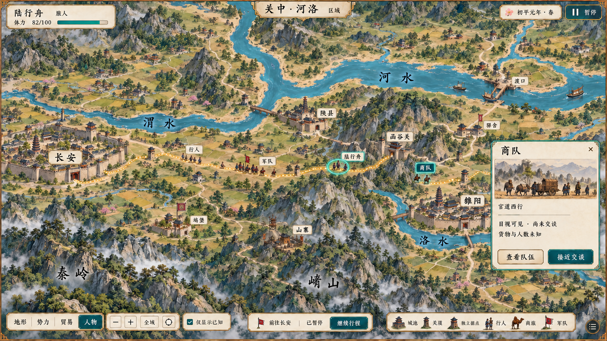

# 关中—河洛区域行旅界面 v0.1

日期：2026-10-04。状态：**静态效果图待用户评审，未接入游戏。**

本图是世界地图全域目标图之后的区域缩放示例，重点展示长安—雒阳方向的道路、关渡、独立据点和途中队伍。它不是城市内部画面，也不是已经运行的地图。

## 画面与操作

- 长安、陕县、函谷关、雒阳以及渭水、河水、洛水组织区域空间；官道与支路连接地点。
- 玩家队伍、普通行人、商队和军队分别表现；坞堡和山寨使用独立地点标识，不由附近城池自动代表其所有权。
- 选中商队后，右侧显示“目视可见·尚未交谈”“货物与人数未知”，提供“查看队伍”“接近交谈”入口。
- 人物图层、缩放、返回全域和“仅显示已知”沿用上一张的界面语言；当前行程暂停，并保留“前往长安／继续行程”。
- 对初次生成结果做了一次局部图像编辑，把高亮主路引入函谷关门，并移除紧邻南侧的绕行段。出口部分被地形遮挡，不能把目视道路连接当作寻路已验证。

## 年代命名与地理边界

本图采用东汉名称“雒阳”；上一张全域图中的“洛阳”仍保留原图，列入后续文字校准。函谷关按新安汉函谷关的历史对象处理，不把灵宝秦关与汉关混为一处。

参考：[汝州市政府《建置沿革》](https://www.ruzhou.gov.cn/contents/37757/502020.html)记述东汉“雒阳”及曹魏改回“洛阳”；[中央纪委网站河南丝路遗产介绍](https://m.ccdi.gov.cn/content/fe/02/16683.html)说明新安汉函谷关与长安—洛阳道路的关系。这两项只支持名称与对象区分，不验证本图的坐标、古河道、桥渡、航行条件或全线距离。

“初平元年·春”、体力、队伍数量和地点布局均为画面示例；图中城池状态不代表已复原某一天的历史事件。具体地图比例、海拔表现、河流走向和过河设施仍需地理底稿校准，画中据点与驿舍不新增正式内容数量。

## 正式制作与验证范围

最终图由内置 imagegen 生成并局部编辑，地形、文字、路线、单位和 UI 烘焙在同一张 PNG。正式游戏应分层制作并由共同地图坐标与世界状态驱动；全域、区域和近场不能复制成三个独立世界。距离、移动、可交互范围、关隘通行、渡运及可知信息以运行数据为准。

“接近交谈”是目标界面入口；与移动目标接近、路径变化、失去目视、实际交谈条件及行程恢复尚未验证。本图没有完成程序拼接、寻路、动态移动、缩放或 Godot 验收。

文件：`region-map-ui.png`（1672×941 RGB，3,121,799 字节）；`prompt.md`保存完整生成提示词及一次局部修订。目视检查覆盖整体风格、主要对象、关口入口、商队面板与行程保留。全域图、城域 v0.3、场所卡片 v0.4 仍保持待评审；既有市场画风认可不等于区域地图自动通过。
