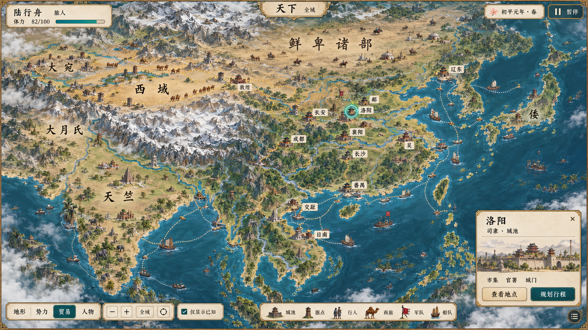

# 世界地图全域目标图 v0.1

日期：2026-10-04。状态：**静态视觉目标待用户评审；地理、历史命名及运行接入未验收。**

本图承接用户确定的扩大范围：北方纳入今蒙古国一带及相关游牧活动区域，西至中亚部分，南含越南、泰国等东南亚地区与印度部分，东含日本列岛。采用近俯视二维手绘地形，现代地理只作位置与尺度参照，画面使用汉末称谓方向。

## 本图展示

- 山脉、草原、荒漠、河流、海岸与城池、驿站及据点符号，配合陆上商旅和海上船队。
- 当前打开贸易图层，以虚线表现陆路和海路联系；不代表这些路线已按初平元年逐段考证。
- 左上旅人状态，右上示例日期与暂停，左下图层、缩放、回中及“仅显示已知”。
- 底部区分城池、据点、行人、商旅、军队、船队；右下以洛阳为选中示例，提供“查看地点”“规划行程”。

## 制作边界

这是一张由内置 imagegen 生成的完整效果图。UI、地名、路线、人物和船只均烘焙在 PNG 中，不是实际程序组合、可点击界面或运行截图。正式游戏须把地形、建筑/据点符号、文字、路线、移动单位、可知范围和界面拆成独立层，由同一地图坐标与世界状态驱动。不能据本图固定城市数量、城池布局、单位规模、势力范围或贸易规则。

北方完整覆盖、地区比例、古河道与海岸、城池及据点坐标、地名逐字/逐年适用性和通路可行性尚未校准。生成图只评审整体绘画与信息组织，不能作为精确历史地图或距离计算依据。图中的“初平元年·春”、人物体力和选中地点是画面示例，不新增游戏设定。

## 文件与检查

- `world-map-ui.png`：1672×941，RGB，3,199,883 字节。
- `prompt.md`：本次完整生成提示词和执行方式。
- 已目视检查整体范围方向、陆海关系、主要标签、地图图例、贸易层及选中地点面板；地图精度与具体汉末名称仍待专门校准。
- 未完成分层源资产、程序地图组合、动态对象移动、缩放等级、路径寻路、真实交互或 Godot 验收。本次没有修改游戏逻辑或运行资源清单。
- 市场主方案的视觉认可、街区组合未验证、城域 v0.3 与场所卡片 v0.4 待评审等旧状态保持不变。

本图为用户要求的世界地图第一版，尚未得到用户的视觉验收。提示词中的约束不等同于最终输出已满足全部地理或历史要求。
